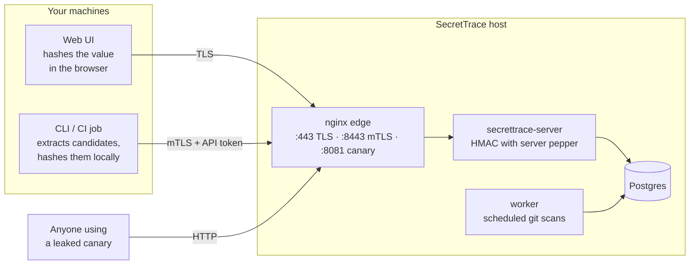

# SecretTrace

**Know whose secret leaked.** Self-hosted leak detection for the secrets you already own: a registry of
fingerprints, git and CI scanning, and canary tokens. Secret values are never stored.

[](https://github.com/MaxsudAmirxanov/secrettrace/actions/workflows/ci.yml)
[](LICENSE)


**English** · [Русский](README.ru.md)

> **Status: alpha.** It works end to end and is covered by unit, integration and E2E tests, but it has had no
> external security review and there is no tagged release yet. Read [Limitations](#status-and-limitations)
> before you deploy it anywhere that matters.

## What it is

Pattern scanners like gitleaks and TruffleHog answer "does this look like a secret?". SecretTrace answers a
different question: **"is this one of *our* secrets, whose is it, and is it allowed to be here?"**

You register each secret once. The value is normalized and hashed on your machine (CLI or browser), and the
server keeps only a keyed fingerprint, an owner, an expiry date and a set of *allow rules* (the places where
that secret is supposed to live). Every scan of a repository, a directory or a CI job then reports exact
matches against that registry.

- **No false positives on registered secrets.** A match is an exact fingerprint match, with a name and an
  owner attached, not a regex guess.
- **Secrets without a format.** Database passwords, internal tokens and values in MCP or app configs have no
  recognizable prefix. They are still found, because matching does not depend on format.
- **Leaks after rotation.** Revoked and rotated secrets stay in the registry. If an old value shows up again,
  it is reported as a leak.
- **Canary tokens in the same place.** Plant bait URLs and API keys where real secrets leak from (`.env`
  files, wikis, CI variables, backups). When someone uses one, you get an alert in the same UI.

It is meant to run **next to** a pattern scanner, not instead of one: the scanner finds unknown secrets, and
SecretTrace tracks the known ones.

## How it works



1. **Digest on the client.** `digest = SHA-256("secrettrace/v1\0" || normalize(value))`. The value never
   leaves the machine. The browser uses a TypeScript port of the same code, checked against the shared test
   vectors in `testdata/digest_vectors.json`.
2. **Fingerprint on the server.** The server stores `HMAC(pepper, digest)`. Pepper keys are versioned and can
   be rotated. A database dump alone is not enough to test guesses offline.
3. **Two-phase ingest.** A scanner first sends the digests of all candidates and learns which ones are
   registered (`/match`). Then it sends locations only for those (`/findings`). Unregistered candidates are
   never stored. Both endpoints share a per-token budget, so the API is not a cheap oracle for guessing
   passwords.
4. **Allow rules.** Each location is checked against the secret's rules (source type, URI, path glob,
   environment). A match outside the rules is a violation.

## Features

**Registry and access**
- Secrets with owner, purpose, expiry, status (`active`, `revoked`, `rotated`) and allow rules.
- Password login plus mandatory TOTP for every role. Roles are `viewer`, `operator` and `admin`.
- Tamper-evident audit log (hash chain). The runtime database role cannot `UPDATE`, `DELETE` or `TRUNCATE` it.
- Scoped API tokens for agents and CI. Tokens can be bound to a client certificate CN, a source URI pattern
  and an environment.

**Scanning**
- `secrettrace scan fs` and `secrettrace scan git`. Git scans cover all branches, stash and full history.
  Each unique blob is read once, however many commits contain it.
- Candidate extraction: 24 known-format rules (`AKIA…`, `ghp_…`, `glpat-…`, `xoxb-…`, `sk-ant-…`, JWT and
  others), PEM keys, passwords in URLs, key/value pairs in `.env`, YAML, JSON, XML, `.netrc` and connection
  strings, `Authorization` headers and high-entropy strings. Base64, percent-encoding and JSON escaping are
  decoded recursively, up to three levels deep.
- Linear-time extraction on hostile input: no backtracking regex, plus size and candidate limits.
- Hostile-repository hardening: no symlink following, no inherited `GIT_DIR`, replace refs disabled,
  revisions passed after `--end-of-options`.
- A server-side worker scans git repositories on a schedule and incrementally. It uses an outbound host
  allowlist, SSRF and DNS-rebinding checks, and credentials pinned to specific hosts.

**CI**
- Exit codes are built for pipelines: `0` clean, `1` registered secrets found, `2` error or incomplete scan.
  An incomplete scan never looks clean.
- Ready-made examples for [GitHub Actions](deploy/ci/github-actions.yml) and
  [GitLab CI](deploy/ci/gitlab-ci.yml).

**Canary tokens**
- `url` canaries (a link) and `api_key` canaries (a service URL plus an `ak_…` key in `.env` format).
- A dedicated edge listener answers every request with the same `404`, so a hit looks the same as a miss.
  Only an HMAC of each token is stored.
- `api_key` canaries are also registered as secrets, so a scan that finds one reports it like any other leak.

**Deployment**
- Docker Compose stack: Postgres, a one-shot migration, server, worker and an nginx edge.
- TLS for the UI and API. mTLS with CRL checks for ingest. A small PKI script (`make pki`, `make client-cert`,
  `make revoke-cert`).
- A distroless server image, non-root containers, read-only filesystems, dropped capabilities, Docker secrets and separate database roles
  for migrations and runtime.

## Quick start

Requirements: Docker with Compose v2, `openssl` and `make`. Rust 1.89+ is needed only to build locally.

```sh
git clone https://github.com/MaxsudAmirxanov/secrettrace.git
cd secrettrace

make up                 # generates secrets and a local CA, builds images, starts the stack
curl -s --cacert deploy/pki/out/ca/ca.crt https://localhost/healthz    # {"status":"ok"}
make admin NAME=alice   # first admin; then open https://localhost and enroll TOTP
```

The first build takes a few minutes. Ports bind to `127.0.0.1` by default. The browser does not trust the
generated CA: import `deploy/pki/out/ca/ca.crt` or use a certificate from your own CA.

The worker refuses to start until you set `ST_WORKER_ALLOWED_HOSTS` (for example `github.com,gitlab.example`)
in `.env` next to `docker-compose.yml`. This is deliberate: without an allowlist an operator could point it at
your internal network.

**Back up `deploy/secrets/pepper_keys`, `data_key` and `canary_key`.** Without the pepper, fingerprints can
be neither checked nor recomputed. Without the data key, every user has to re-enroll TOTP.

## Using it

Register a secret. The CLI reads the value without echoing it, hashes it, wipes it from memory and sends only
the digest:

```sh
cargo install --path crates/st-cli      # installs the `secrettrace` binary

secrettrace register --server https://st.example.com -u alice \
  --name prod-db-password --type password --owner platform --expires 2027-06-01
```

Scan in CI (the token is created by an admin, the client certificate with `make client-cert CN=ci-infra`):

```sh
export SECRETTRACE_TOKEN=stk_...          # never pass tokens as arguments: argv is visible in `ps`
export SECRETTRACE_CA_CERT=ca.crt
export SECRETTRACE_CLIENT_CERT=client.crt SECRETTRACE_CLIENT_KEY=client.key

secrettrace scan git . --server https://st.example.com:8443 --environment ci
```

See what the extractor sees, locally and without a server (it never prints values):

```sh
secrettrace extract .env k8s/secret.yaml
secrettrace scan git . --locate --min-confidence medium
```

The full API is described in [`docs/openapi.json`](docs/openapi.json), and the server also serves it at
`GET /api/v1/openapi.json`. Configuration is documented in [`.env.example`](.env.example).

## When to use what

| Tool | Finds | Use it for |
|---|---|---|
| gitleaks, TruffleHog | anything that looks like a secret | finding secrets you didn't know about |
| **SecretTrace** | your registered secrets, with or without a format, plus canary hits | ownership, allowed locations, leaks after rotation, self-hosted |
| Canarytokens | canary hits | quick standalone tripwires |
| GitGuardian, HCP Vault Radar | both, as a commercial service | teams that are fine with SaaS |

They work best together. For example, run gitleaks in pre-commit and SecretTrace in CI and on a schedule.

## Security model

**Stored:** secret names, owners, expiry dates, allow rules, keyed fingerprints, optional hints (such as a
known prefix like `AKIA` and the length), locations (path, line, commit, blob) and an audit log.

**Never stored or logged:** secret values, file contents, client-side digests, or the text of remote git
errors.

The threat model, with trust boundaries and the attacks considered, is in
[`docs/threat-model.md`](docs/threat-model.md). The architecture is in
[`docs/architecture.md`](docs/architecture.md). Both are in Russian for now; English versions are planned.

Found a vulnerability? Please report it privately, as described in [SECURITY.md](SECURITY.md).

## How this was built

SecretTrace was built with AI coding agents (Claude Code) under my direction: agentic engineering, not
autopilot. I set the goals, the architecture constraints and the threat model scope, and I reviewed the
results. Agents wrote most of the code and tests. Separate adversarial agent passes attacked each stage, and
their findings are fixed in the code and recorded in the threat model. The `Co-Authored-By` trailers in the
git history are left as they are on purpose.

I'm now reviewing the code line by line, starting with the fingerprint protocol, the nginx mTLS and CN
handling, and the git worker. Review of those parts is especially welcome.

## Status and limitations

Done: registry, authentication with TOTP, audit log, extraction, fs and git scanning, ingest API, worker,
CLI, web UI, TLS and mTLS edge, canary tokens, and an E2E test of the real Compose stack.

Not done yet, or known gaps:
- **No notification delivery yet** (email, Telegram, webhooks). Canary hits create alerts in the UI.
  Violations are visible in the UI and through CLI exit codes.
- **The web UI is in Russian only.** English is next on the list.
- **Client-side digests use a fixed domain separator, not a per-install salt.** Treat digests as sensitive:
  a digest of a weak password can be brute-forced. `extract` and `scan` print digests only with
  `--show-digests`.
- Most design docs are in Russian.
- No tagged release, signed binaries or published images yet. Build from source.
- No external security audit.

## Development

```sh
make test        # unit and integration tests (starts a throwaway Postgres in Docker)
make lint        # rustfmt --check and clippy pedantic with -D warnings
make web-test    # web UI tests (vitest)
make e2e         # builds the images and tests the real Compose stack from outside
make help        # all targets
```

```
crates/st-core     normalization, digest, hints, masking (shared by server and clients)
crates/st-extract  candidate extraction from text
crates/st-source   filesystem and git sources, extraction thread pool
crates/st-server   API (axum), auth, worker, admin commands, audit, pepper
crates/st-cli      the `secrettrace` CLI
web/               web UI (React + TypeScript), browser port of the digest code
migrations/        SQL migrations (embedded in the binary)
deploy/            Compose, nginx edge, PKI script, CI examples, E2E
docs/              architecture, threat model, ADRs, OpenAPI
```

Bug reports and questions are welcome in [Issues](https://github.com/MaxsudAmirxanov/secrettrace/issues).
For larger changes, please open an issue first.

## License

[Apache License 2.0](LICENSE).
